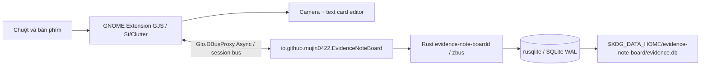
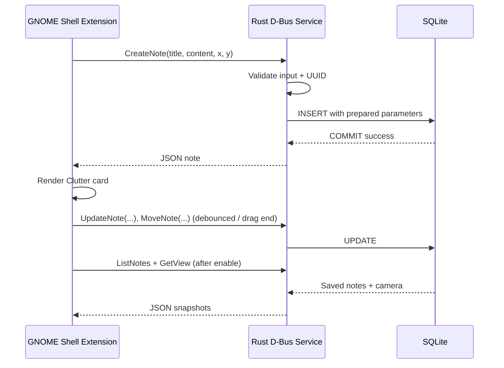

# Kiến trúc hệ thống Evidence Note Board

## 1. Kiến trúc theo từng phase

**Phase 1 (PoC, chưa xác minh trên thiết bị):** GNOME Shell Extension nhúng `St.Widget` vào `Main.layoutManager._backgroundGroup`, nằm theo thiết kế dưới ứng dụng; sử dụng `canvasMath.js` để transform camera. Đây là **API private**, không cam kết tương thích lâu dài. GNOME Classic bổ sung panel/extension, cần test stacking, focus và đa màn hình.

**Phase 2 (implementation hiện tại, chờ nghiệm thu):** giữ extension trên GNOME Shell; thêm backend Rust user service + SQLite, giao tiếp D-Bus bất đồng bộ. Không gọi SQLite từ compositor, không khởi tạo web app.

**Chưa code:** import image, pins, connections, migrations > v1, packaging RPM, Undo/Redo, nhiều board. Schema có tables chuẩn bị trước cho phase 3–4 nhưng chưa có logic sử dụng.

## 2. Phương án kỹ thuật

| Phương án | Được | Không được |
|---|---|---|
| GNOME Shell Extension + Rust backend (đang triển khai) | Background actor + I/O ở tiến trình riêng, lưu local | API `_backgroundGroup` private, GNOME Classic chưa kiểm thử |
| GTK/Qt app window được extension tích hợp vào desktop | Tách GUI khỏi Shell | Focus/stacking trên Wayland khó, nhiều thành phần |
| App window GTK/Qt thuần | Dễ phát triển | Không bảo đảm dưới mọi cửa sổ trên GNOME Wayland |

## 3. D-Bus API — Phase 2

- Bus: `session`
- Name/interface: `io.github.mujin0422.EvidenceNoteBoard`
- Object: `/io/github/mujin0422/EvidenceNoteBoard`
- `ListNotes() -> s` (JSON array)
- `CreateNote(s title, s content, d x, d y) -> s` (JSON object)
- `UpdateNote(s id, s title, s content)`
- `MoveNote(s id, d x, d y)`
- `DeleteNote(s id)`
- `GetView() -> s` (JSON object)
- `SaveView(d zoom, d panX, d panY)`

Giao thức JSON được giới hạn ở kết quả đọc để dễ mở rộng record; argument mutation vẫn là D-Bus typed values. D-Bus session bus được giới hạn theo người dùng, nhưng tiến trình cùng user có thể gọi các method; đây **không phải ranh giới bảo mật để lưu secret khỏi các app cùng user**.

## 4. SQLite

- Data: `$XDG_DATA_HOME/evidence-note-board/evidence.db`; mặc định `~/.local/share/evidence-note-board/evidence.db`.
- Embedded `rusqlite` `bundled`, PRAGMA `foreign_keys=ON`, `journal_mode=WAL`, `busy_timeout=3000`.
- Migration `db/migrations/0001_init.sql` áp dụng trong transaction khi `user_version=0`, đánh dấu version 1. Reject version > 1; không hạ cấp database.
- Bảng hoạt động: `boards`, `notes`, `board_view_state`. Schema dự phòng: `assets`, `pins`, `connections` (không thao tác).
- UUID cấp bởi backend; chỉ xử lý `type=text`, board mặc định `default`.
- Prepared SQL, giới hạn title 512 bytes, body 65,536 bytes, finite position và zoom 0.25–3.
- Thay đổi text ghi sau debounce 500ms, drag chỉ ghi cuối lần kéo; camera sau debounce 550ms.
- Không xóa `evidence.db` khi gỡ, backup lúc service đã dừng.

## 5. Failure paths và độ tin cậy

- Backend không chạy: extension vẫn mount background nhưng hiển thị `BACKEND OFFLINE`; không tạo note giả. Chạy `systemctl --user ...` và bật lại extension.
- GJS không dùng D-Bus sync; mọi mutation async và serialized client-side.
- Lỗi DB trả về D-Bus error (không log nội dung note); UI hiển thị lỗi lưu.
- Enable/disable hủy actor, signal, pointer grab và timeout; các writes đang gửi có thể hoàn tất khi disable, cần thử trên máy thật.
- Nếu GNOME private background group không tồn tại: fail closed, không tạo always-on-top overlay.
- Backend chạy systemd user scope; chưa có D-Bus activation. Nếu backend restart sau khi extension bật, hiện cần **disable/re-enable extension** để kết nối lại.

## 6. Những vấn đề chưa xác minh

GNOME Classic 50.5 pointer/focus/input, `Clutter.Text` multiline editing, `Gio.DBusProxy` introspection trên session thật, systemd user service cài trên Fedora, crash recovery, clipboard/IME tiếng Việt, race khi logout lúc debounce, shell/GPU đa màn hình, benchmark. Không đưa các mục đó vào nhóm 'PASS' chỉ dựa trên source hoặc CI.

Tài liệu API: https://gjs.guide/guides/gio/dbus.html · https://docs.rs/zbus/latest/zbus/ · https://docs.rs/rusqlite/latest/rusqlite/

## Phase 3 — Image asset pipeline (đang thử nghiệm)

`Zenity chọn file -> GJS ImportImage(path,x,y) async -> Rust validate
format/dimensions -> copy assets/UUID.ext -> SQLite transaction -> JSON
note -> GNOME St.Icon Gio.FileIcon`.

SQLite schema Phase 1 đã có `assets` (file_path, mime, width, height,
checksum). Phase 3 tái dùng schema v1, không nâng user_version. File ảnh
được lưu theo UUID do backend tạo để tránh ghi đè và path traversal.
Phía compositor không giải mã ảnh nguồn trước khi nhập; GJS chỉ hiển thị
bản sao đã được Rust xác minh. Nút file picker dùng Zenity process không
block GNOME Shell. Đây chưa phải kiến trúc release cuối cùng; portal
FileChooser được cân nhắc thay Zenity ở Phase 5.

## Phase 5 production integration update

User settings use XDG_CONFIG_HOME/evidence-note-board/settings.json, not
SQLite schema modifications. Rust's typed SaveSettings validates data
and atomically renames a temporary file; GNOME Settings overlay is a
small St.BoxLayout on the primary monitor.

Phase 5 now targets one screen only. Toolbar location is defined by
`singleScreenLayout(stageWidth, stageHeight)`, not by monitor enumeration.
Note/connection storage remains world-space. On backend loss,
GJS preserves note actors/dirty content, retries D-Bus with capped
exponential backoff and persists changes after reconnect.

Wire render is stage-sized St.DrawingArea, throttled redraw and screen
culling. No GPU frames benchmark is inferred from this approach.
SQLite backup and SHA-verified asset restore are an explicit CLI workflow,
not an automatic destructive recovery on app startup. See
[PHASE_05](phases/PHASE_05.md).
