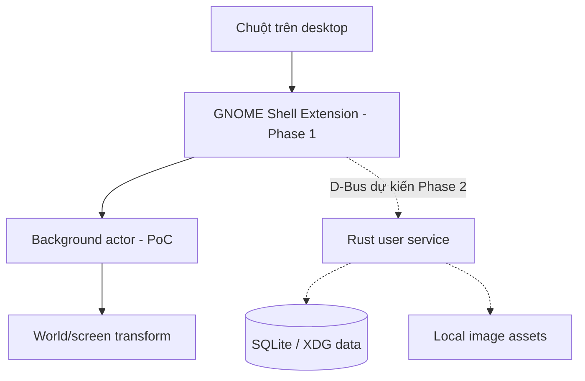

# Kiến trúc — Phase 1 GNOME Classic Wayland

Trạng thái: **đã thực hiện PoC ở mức source; chưa xác minh trên Fedora GNOME Classic 50.5 thật**.

## 1. Ràng buộc compositor

GNOME sử dụng Mutter trên Wayland. Một cửa sổ GTK/Qt thường không thể tự ý nằm dưới mọi ứng dụng hoặc thay ảnh nền chỉ bằng một giao thức window stacking. Không giả định hỗ trợ `wlr-layer-shell` (giao thức của compositor khác). GNOME Classic vẫn dùng GNOME Shell nhưng có cấu hình session và extension khác GNOME mặc định.

Trong mã nguồn **GNOME Shell 50.4**, `js/ui/layout.js` tạo `Meta.BackgroundGroup` dưới `global.window_group` và quản lý các background actor theo monitor. Điều này hỗ trợ phương án PoC, nhưng `Main.layoutManager._backgroundGroup` là trường **private**. Không đồng nhất việc đọc mã 50.4 với xác minh nhị phân GNOME Shell **50.5** mà người dùng đang chạy.

Tài liệu nền:
- GNOME Shell layout 50.4: https://raw.githubusercontent.com/GNOME/gnome-shell/50.4/js/ui/layout.js
- Extension anatomy: https://gjs.guide/extensions/overview/anatomy.html
- Session modes: https://gjs.guide/extensions/topics/session-modes.html
- GNOME Classic Fedora package: https://packages.fedoraproject.org/pkgs/gnome-shell-extensions/gnome-classic-session/

## 2. So sánh kiến trúc

| Phương án | Ưu điểm | Nhược điểm | Quyết định |
|---|---|---|---|
| GNOME Shell Extension (GJS, Clutter/St) + Rust/SQLite sau này | Có thể gắn actor ở layer desktop; không giả lập wallpaper window | Phụ thuộc private API, lỗi JS ảnh hưởng Shell | **PoC được chọn**, cần test thực tế |
| GTK4/Qt application + extension phụ trợ để tích hợp desktop | Có GUI toolkit riêng và tách logic khỏi compositor | Phải phối hợp stacking/focus trên Wayland, phức tạp và không chắc tương đương wallpaper | Phương án dự phòng cần nghiên cứu |
| GTK4/Qt window độc lập | Dễ phát triển và debug | Không đáp ứng yêu cầu desktop layer GNOME Wayland | Không chọn |

## 3. Sơ đồ hệ thống

**Đã code:** Extension, actor, camera và xử lý sự kiện. **Chưa code:** Rust, D-Bus, SQLite runtime, assets.

## 4. Cấu trúc

- `extension/extension.js`: enable/disable, lỗi mount.
- `extension/boardView.js`: actor, event handling, pointer grab, signal cleanup.
- `extension/canvasMath.js`: logic tọa độ thuần JavaScript.
- `extension/stylesheet.css`: charcoal, thẻ minh họa vintage.
- `tests/`: test camera, schema SQL ở dạng thiết kế và kiểm tra package.
- `scripts/`: cài thử và tạo ZIP.
- `db/migrations/`: schema **chưa được sử dụng**, lưu lại như bản thiết kế Phase 2.

## 5. Quyết định kỹ thuật và rủi ro

1. Thêm actor vào background group nhưng **không sửa chính Mutter, không monkey-patch GNOME Shell**.
2. Nếu group không tồn tại, thất bại an toàn; không tạo cửa sổ thay thế.
3. Khi monitor thay đổi, tự điều chỉnh kích thước và đưa actor lên trên các wallpaper actor mới; vẫn giữ dưới application windows nhờ hierarchy.
4. Chỉ grab con trỏ trong lúc middle-drag; dismiss grab khi thả chuột hoặc disable.
5. Không lưu dữ liệu người dùng, chưa khởi chạy backend, không cần root.
6. GNOME Classic có extension panel/dock/desktop riêng: input propagation, Overview, fullscreen, đa màn hình là **đầu mục kiểm thử chưa xác minh**.
7. `Meta.BackgroundGroup` và `_backgroundGroup` có thể đổi giữa phiên bản GNOME; không tự suy diễn tương thích với GNOME 51.
8. Một phiên bản Fedora chỉ được gọi là hỗ trợ sau khi kiểm thử trực tiếp, không chỉ vì CI xanh.

## 6. Acceptance gate

Cần ảnh/video hoặc báo cáo thực tế trên GNOME Classic 50.5 Wayland: board đúng layer, Firefox/Terminal ở phía trên, top bar/dock không che, zoom/pan, enable/disable, Overview, monitor change và không có lỗi GNOME Shell. Chi tiết tại [TESTING](TESTING.md). Chưa hoàn tất cho đến khi có bằng chứng này.
