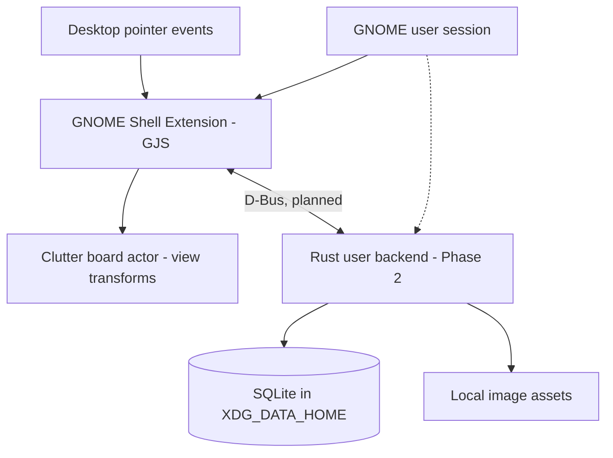

# Architecture decision — Fedora GNOME Wayland

**Status:** Proposed architecture and technical PoC. No claim of on-device validation.

## Constraint

GNOME Wayland does not offer arbitrary application windows an API to become the native wallpaper layer. The wlroots `wlr-layer-shell` protocol cannot be assumed to work on Mutter. The shell extension takes responsibility for placement and rendering; regular applications do not receive unrestricted window stacking permissions.

## Options

| Option | Pros | Cons | Decision |
|---|---|---|---|
| GNOME Shell Extension (GJS/Clutter) + Rust/SQLite backend | Genuine compositor background layer; native event delivery; backend separated from compositor | Shell internals change with releases; extension bugs can affect GNOME Shell | **Selected**, gated on Phase 1 proof |
| External GTK/Qt window, GNOME extension lowers/manages it (DING-like) | Native toolkit editors; renderer outside shell process | Complicated Wayland identity, focus and stacking integration; behaves like a window; more moving parts | Fallback research path |
| Standalone GTK/Qt app window only | Stable toolkit; easy to debug | Does not meet wallpaper-level requirement on GNOME Wayland | Rejected for core board |

## Critical integration detail

GNOME Shell 50 `js/ui/layout.js` creates `Main.layoutManager._backgroundGroup` as a child of `global.window_group` and positions it **below window actors**. Phase 1 adds an interactive `St.Widget` above wallpaper backgrounds within that group. This uses a **private** underscore-prefixed API; it is a deliberate compatibility risk, not a GNOME guarantee.

Do not ship RPM or claim Phase 1 complete until pointer events, overview, monitor handling and stacking have been tested on Fedora 44 GNOME 50 Wayland. Interference from desktop-icon extensions must also be checked.

## Intended system

The existing code implements only `Pointer -> Shell -> Canvas`. Dashed and Phase 2 components are proposals, not working features.

## Planned data flow

- Create note: board interaction -> validate input in Rust service -> SQLite transaction -> notify/update rendering.
- Move note: update geometry locally per frame -> debounced final state -> backend transaction.
- Connect: pin-to-pin selection -> validate IDs -> persist graph edge -> repaint wire.
- Import image: backend validates size/type -> copies to XDG assets -> persists metadata/asset.
- Restore: login enables extension -> user service loads rows -> sends board snapshot -> restore camera/notes.

Security: never expose arbitrary file read/write over D-Bus; validate types and paths, use user-level services only. Store `evidence.db` under `~/.local/share/evidence-note-board/`; do not mutate the installation directory.

## Code boundaries

- `extension/extension.js`: lifecycle, GNOME-specific actor and pointer interaction.
- `extension/canvasMath.js`: pure world/screen transforms, independent of GNOME for testing.
- `db/migrations/`: planned versioned schema; not integrated.
- Future `backend/`: Rust repository and service layer; not created yet.
- Future `packaging/`: RPM; not created yet.

## Key risks

1. `_backgroundGroup` is private and may move, change or stop receiving events.
2. GNOME Shell is the compositor process; buggy extension code can impair the desktop.
3. Monitor hotplug, GNOME Overview and multiple workspaces require device-level testing.
4. User input may be consumed by shell shortcuts/other extensions.
5. Later IPC/database calls must not block the Shell main thread.

## Evidence / references

- GNOME Shell 50.4 `js/ui/layout.js`: https://raw.githubusercontent.com/GNOME/gnome-shell/50.4/js/ui/layout.js
- GNOME extension anatomy: https://gjs.guide/extensions/overview/anatomy.html
- GNOME debugging / Wayland nested shell: https://gjs.guide/extensions/development/debugging.html
- Fedora 44 GNOME 50: https://fedoramagazine.org/whats-new-fedora-workstation-44/
